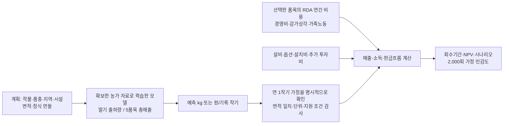

# 데이터 확인·성능 검증·경제성 연결

2026-10-11 기준. 실제 확보 자료로 검증하고 로컬 앱과 공개 웹에 모델 예측을 연결했습니다. 대회 미개방 원자료의 현장 검증이나 미래 농가의 투자성과를 검증한 결과는 아닙니다.

## 어떤 자료를 다시 확인했나

원본 ZIP/XLSX, 정규화 CSV, API 작기·시설 목록의 저장된 SHA256을 다시 대조했습니다. 원본을 수정하거나 극단값을 임의로 나누지 않았습니다. 기존 원값 포함 실험도 유지합니다.

| 새 계획 모델 | 원래 비교 자료 | 현재 계획 모델 코호트 | 제외·보류 이유 |
|---|---:|---:|---|
| 딸기 출하량 | 77작기·61시설 | 76작기·61시설 | 기존에 표시된 단위 검토 극단값 1건 보류 |
| 5품목 총매출 | 192작기·146시설 | 189작기·143시설 | 기존 매출 검토 1건과 API 면적 미확인 2건 보류 |

매출 모델의 면적은 지역 XLSX의 평/㎡ 변환값을 쓰지 않습니다. 시설ID·작기 시작/종료일·품목이 정확하게 유일하게 연결되고, API 작기와 시설 목록의 양수 면적이 일치한 값만 사용합니다. 이 조건부 하위집단의 점수를 원래 전체 자료 성능으로 바꾸어 제시하지 않습니다.

공식 ADP 메타 정보도 다시 확인했습니다. 제목은 2024 자료지만 2024/25 작기 자료이며, 다음 해 날짜가 포함될 수 있고 추가 업데이트가 없는 1회성 자료라고 안내합니다. 파일명 연도를 단일 달력연도로 처리하거나 같은 자료를 다시 받아 새 학습 표본으로 늘리지 않았습니다. [농촌진흥청 공식 메타 정보](https://adp.rda.go.kr/portal/pub/data/dataDetail.do?dataId=4163&dataTypeCd=PBLCATE)

## 성능을 어떻게 검증했나

5개 바깥 시설 분할에서 성능을 평가하고, 각 바깥 학습 자료 안의 3개 시설 분할에서 방법을 선택했습니다. 바깥 평가 정답으로 방법을 고르지 않았습니다. 입력 인코딩도 각 학습 분할에서만 맞췄습니다. 면적당 중앙값·로그 면적당 수량/매출 CatBoost·XGBoost를 비교했고, 예측 후 계획 면적을 한 번 곱합니다.

| 목표 | 중첩 모델 선택 절차 MAE | 고정 면적당 중앙값 MAE | 판단 |
|---|---:|---:|---|
| 딸기 기록 출하량 | 7,095.09kg/작기 | 6,837.66kg/작기 | 전체에서는 단순 기준이 더 작음 |
| 5품목 기록 총매출 | 143,992,069원/작기 | 139,606,535원/작기 | 전체에서는 단순 기준이 더 작음 |

이는 최종 전체 자료 재학습 모델 하나의 독립 테스트 점수가 아니라, 학습 자료 안에서 모델을 고르는 **절차**의 검증 점수입니다. 전체 학습 자료에서 최종 선택된 방법은 딸기 출하량 XGBoost, 총매출 품목별 면적당 중앙값입니다. 높은 투자 예측 정확도를 확보했다고 주장하지 않습니다.

추가 시간 검증은 최신 정식연도의 농가를 보류하고, 이전 연도의 자료 중 같은 시설이 겹치는 행을 제거했습니다. 딸기 2024년 7작기에서는 중앙값 MAE 5,416.35kg, 매출 2023년 5작기에서는 선택된 CatBoost 91,187,844원·중앙값 106,432,458원이었습니다. 표본이 작고 후향 내부 검증입니다. 새 외부 농가 시험은 완료하지 않았습니다.

기존 생육 실험은 시설별 OOF 예측 CSV 해시·분할과 모든 MAE를 다시 계산해 확인했습니다. 가격 실험은 2021–2023 학습 → 2024 선택 → 2025 고정 평가를 다시 실행하여 저장 점수와 일치했습니다. 가격은 선택 방법 1,249.16원/kg·계절 기준 1,061.62원/kg으로 기준이 더 좋았습니다.

## 어떤 예측이 계산에 들어가나



출하량 경로는 예측 kg를 계획 면적으로 나눠 1,000㎡ 기준으로 환산한 뒤 선택한 농가수취단가를 곱합니다. 총매출 경로는 예측 원을 직접 적용하며 면적이나 판매단가를 다시 곱하지 않습니다. 이때 표시 단가는 매출/참고수량에서 유도한 환산값이며 실측 판매단가가 아닙니다. 매출 경로에서 출하량 경로로 바꾸면 이전 매출 예측을 제거합니다.

작기 기록의 완결성은 원자료만으로 확정하지 못했습니다. 따라서 자동으로 완결된 연간 실적이라고 간주하지 않습니다. 사용자가 연 1작기 가정을 확인해야 연결됩니다. 연간 조사 비용은 면적만 환산하며 작기 수로 다시 곱하지 않습니다. 환경·생육 관측이나 설비의 수확 증가 효과는 이 도입 전 모델 입력에 넣지 않습니다.

로컬 앱의 **농가 작기 모델**과 공개 웹의 **출하량 모델로 계산 / 총매출 모델로 계산**에서 사용합니다. 다른 네 작물은 총매출 경로를 지원하며, 품목을 바꾸면 해당 품목의 전국 소득조사 비용으로 바뀝니다. 조건이 관측 범주·면적·연도 밖이면 그 사실을 표시합니다.

브라우저는 학습된 수치 트리/중앙값 식을 직접 실행합니다. 별도 DB·서버 추론 API는 필요 없습니다. 원본 CatBoost/XGBoost의 float32 분기 정밀도를 보존하고 원래 계획 면적으로 최종 환산했습니다. 검증 보고서와 모델 파일 해시가 다르면 모델 사용을 중단합니다. 실제 농가 행·시설ID·행별 검증값은 배포하지 않습니다.

## 실행 예시와 확인

딸기 1,000㎡ 예시에서 출하량 모델 4,244.35kg → 농가수취단가 10,868원/kg → 매출 46,127,585원으로 연결했습니다. 총매출 모델은 32,991,977원 → 같은 금액의 경제성 입력으로 연결했습니다. 숫자는 조건부 모델·비용 가정을 확인하는 예시이며 개별 농가의 보장된 성과가 아닙니다.

- 전체 로컬 Python 검사: **240개 + 하위 검사 63개 통과**, 이후 DSZ 파일 출처 연결 검사 3개도 통과했습니다.
- 웹 검사: 기본 산식·설비·민감도와 실제 모델/금융 계산 일치 **16개 통과**.
- 브라우저: 기간 동의 전 차단, 면적 변경, 출하량→매출 전환, 다섯 품목 비용/매출 연결, 결과 다운로드, 민감도 실행. JS 오류·실패 요청 0, 모바일 가로 넘침 없음.
- 독립 Python 검토: 원자료/API 면적·시설 분리·시간 분리·계산 연결 확인. 원본 모델과 분기 경계 CatBoost 129개/XGBoost 45개 일치 검사. 발견된 분기 정밀도·이전 매출 잔존 문제는 수정하고 회귀 검사했습니다.

학습·검증·예시 재생성:

```powershell
python scripts/validate_planning_pipeline.py
npm run test:web
npm run build
```

원자료가 별도로 준비된 로컬 연구 환경에서 첫 명령을 실행합니다. 소스만 복제한 웹은 동봉된 수치 모델과 공개 비용 참고자료로 실행할 수 있습니다.

## 대회 미개방 경로도 계산에 연결

기존 `predict_dsz.py`가 만든 예측 CSV와 같은 계획 CSV, 계획ID별 명시적인 비용 JSON을 연결합니다. 비용 JSON은 `{ "0": { ...경제성 입력... } }`처럼 계획ID별로 작성합니다. 계획 CSV에 ID가 없으면 기존 예측기와 동일하게 0부터 순서대로 부여합니다. 품목·면적·단위·연 1작기 가정을 확인합니다.

```powershell
python scripts/connect_dsz_economics.py --predictions runs/demo/predictions.csv --plans data/examples/dsz/example_plans.csv --cost-plans my_cost_plans.json --output runs/demo/economics.json --assume-one-cycle-per-year
```

`synthetic_schema_fixture` 또는 `onsite_private_unverified` 표시는 입력과 최종 계산 결과에 남습니다. 실제 대회 자료의 검증 완료라고 바뀌지 않습니다. 미개방 원자료의 실제 분석·성과 검증은 안심구역에서 수행해야 합니다.

기존 예측의 `.provenance.json`에서 계획 CSV와 예측 CSV의 SHA256·행 수를 확인합니다. 계획ID가 같아도 면적/품목/그 밖의 계획 특징이 바뀌었으면 다시 예측해야 합니다. 최종 결과에 해당 provenance·해시와 비용 계획 JSON의 해시를 보존합니다.

근거: [검증 요약](planning_validation_summary.json), [모델 식](planning_models.json), [브라우저 비용 참고](planning_cost_references.json), [코드](../src/planning_models.py), [대회 계산 연결](../scripts/connect_dsz_economics.py). 로컬 개별 OOF·상세 제외 사유는 `artifacts/planning_validation/`에 보존합니다.
